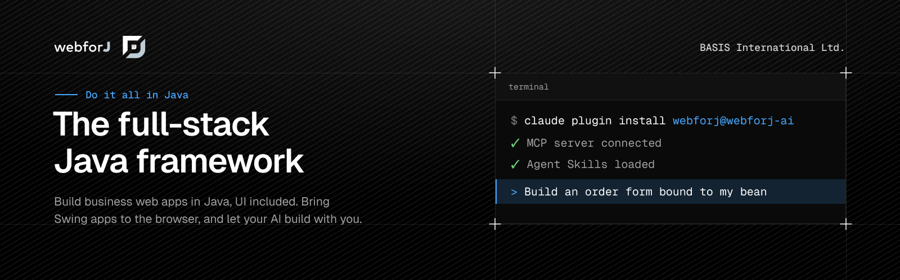

<div align="center">



**The frontend is Java now.**

Build web apps in pure Java, edit them visually while they run, and bring your Swing apps along. webforJ is the AI-ready Java web UI framework, and your AI assistant already knows it. Backed by BASIS International's almost 40 years of expertise, including 20+ years of delivering technology built on Java.

[](https://github.com/webforj/webforj/releases)
[](https://github.com/webforj/webforj/blob/main/LICENSE)

**[Start your first app](https://docs.webforj.com/docs/introduction/getting-started)** · [Documentation](https://docs.webforj.com) · [Blog](https://docs.webforj.com/blog) · [Talk to the team](https://webforj.com/schedule-discovery/)

</div>

## No JavaScript to write. Just Java.

Your views are Java classes, and there's no REST layer between your UI and your backend. Your Spring services go straight into the view.

```java
@Route("/orders")
public class OrdersView extends Composite<FlexLayout> {
  private final FlexLayout self = getBoundComponent();
  private final Table<Order> table = new Table<>();

  public OrdersView(OrderService orders) {
    table.addColumn("Order", Order::number);
    table.addColumn("Customer", Order::customer);
    table.addColumn("Total", Order::total);
    table.setItems(orders.findOpen());

    Button refresh = new Button("Refresh", ButtonTheme.PRIMARY,
        e -> table.setItems(orders.findOpen()));

    self.setDirection(FlexDirection.COLUMN).add(refresh, table);
  }
}
```

**[Generate your first project in the browser with startforJ](https://docs.webforj.com/startforj)**, or follow the [getting started guide](https://docs.webforj.com/docs/introduction/getting-started).

## Install one plugin. Your AI writes real webforJ.

No guessing, no stale training data. One install teaches Claude Code, GitHub Copilot, Cursor, Gemini CLI and Codex the framework through the [webforJ AI plugin](https://docs.webforj.com/docs/ai-tooling).

```bash
claude plugin marketplace add webforj/webforj-ai
claude plugin install webforj@webforj-ai
```

- **[MCP server](https://docs.webforj.com/docs/ai-tooling/mcp):** live access to the webforJ docs, project scaffolding, theme generation and design token validation, so answers come from current documentation instead of training data.
- **[Agent Skills](https://docs.webforj.com/docs/ai-tooling/agent-skills):** step-by-step workflows for building forms, creating components, styling apps, securing routes, async work, localization and version upgrades.
- **[Browserless testing](https://docs.webforj.com/docs/testing/testbed/overview):** views run inside plain JUnit tests, with no browser and no server, so your assistant gets a pass or a fail right after every change it makes.
- **Docs that talk back:** stuck on a page? Open it in ChatGPT or Claude with one click and ask your question right there.

## AI agents that use your app

AI agents are starting to work inside the same apps people do. The automation layer lets an agent use your webforJ app the way a person does, with exactly the permissions of the user it works for.

- **See, find, act:** the agent reads the page as plain text, finds a component by its label or text, and clicks, types and chooses like a user.
- **No back door:** it acts through the UI, so a disabled button stays disabled and anything the user can't reach stays out of reach.
- **Your agent loop:** you pick the model, the prompt and when the agent runs. webforJ supplies the tools.
- **[MCP Apps](https://docs.webforj.com/docs/integrations/mcp-apps/overview):** open a webforJ view inside an AI app's conversation, so the person and the AI work with the same live UI. Experimental.

```java
String page = Snapshot.render(view);
var export = ComponentLocator.of(Button.class).byText("Export").locate();
UserInteraction.click(export);
```

## Visual editing that writes Java

[craftforJ](https://docs.webforj.com/docs/craftforj) edits your app live, right in the browser, while it runs. No IDE plugin, no browser extension, no design file. Click a component, change it, watch the app update, and keep the result in your Java source.

- **Click and change:** select any component in the page and edit its properties while the app runs.
- **Back to source:** review your live edits as a diff and write the ones you keep into your Java files.
- **Routes and theme:** navigate every route, adjust its access rules, and tune the design tokens with an instant preview.
- **An agent, not a chatbot:** give the [craftforJ assistant](https://docs.webforj.com/docs/ai-tooling/craftforj-assistant) a goal, not a command. It plans, inspects the live app, writes Java, compiles it, checks the result and corrects itself across many steps in one turn. When a change restarts your app, it picks its plan up again and finishes the task. Nothing reaches your source without your approval.

## Swing to web, one screen at a time

Run your existing Swing, JavaFX or SWT app in the browser through the [Webswing integration](https://docs.webforj.com/docs/integrations/webswing/overview), then move it to webforJ one screen at a time. Your users get the web version right away, and your team rewrites at its own pace, in the language it already knows.

BASIS International has spent almost 40 years assisting organizations to modernize mission-critical systems. webforJ puts that experience behind your Java apps.

## One design system, every screen

Every component comes from one design system, so screen 200 looks like screen 1. Themes, light and dark modes and design tokens are built in, and the [DWC Design Kit for Figma](https://www.figma.com/community/file/1682060886525639971/) lets designers work with the same components your developers use.

## Build it with us

Found a bug or have an idea? Open an issue in [webforj](https://github.com/webforj/webforj). Not sure where it belongs? Post it there and we'll route it. To contribute code, read the [contributing guide](https://github.com/webforj/webforj/blob/main/CONTRIBUTING.md).

---

<div align="center">

**Do it all in Java.**

[webforj.com](https://webforj.com) · [JavaDocs](https://javadoc.io/doc/com.webforj)

</div>
